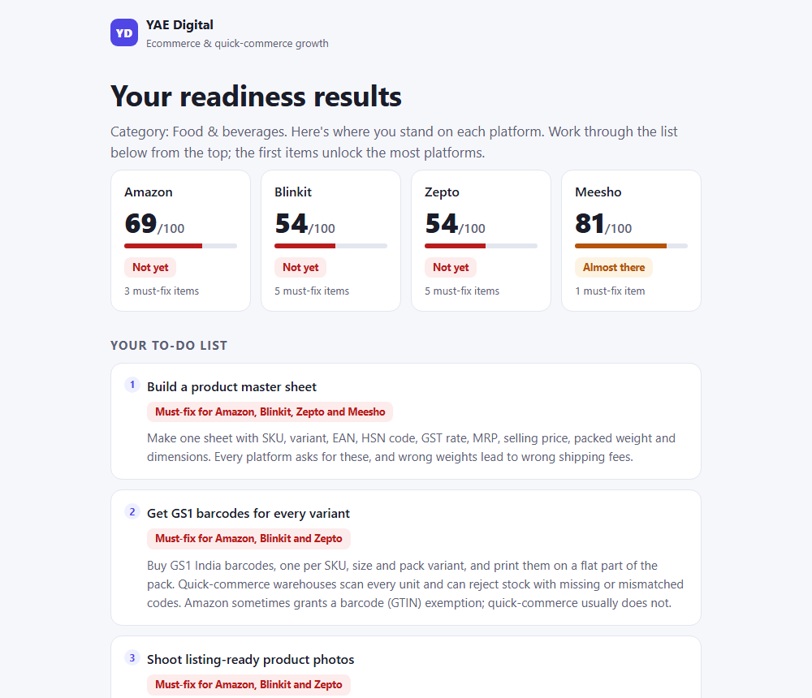

# Marketplace Readiness Check

**Is your brand ready to sell on Amazon, Blinkit, Zepto and Meesho?**
Answer 14 quick questions (about 3 minutes) and get:

- a readiness score out of 100 for each platform
- a to-do list in priority order, with the fixes that unblock the most platforms first
- a plain-language "how to fix it" for every gap (GST, brand proof, GS1 barcodes, FSSAI, Legal Metrology labels, images, packaging, returns and more)

👉 **Try it:** _live link coming soon_

## Who it's for

Founders and D2C brands in India planning to launch on marketplaces or quick-commerce, who want a quick, honest view of what's missing before they apply.

## Privacy

Everything runs in your browser. No sign-up, no tracking, and no answers are saved or sent anywhere.

## How it works

- One self-contained file: [`index.html`](index.html). No framework, no build step, works on phones.
- Questions adapt to your category (for example, food adds FSSAI and shelf life, and electronics adds BIS).
- Each question is marked **must-fix** or **helpful** per platform. Missing a must-fix item blocks you on that platform, and helpful items raise your score.
- All rules live in one `QUESTIONS` list near the top of the script, so they are easy to review and update.

### Use it for your own brand or agency

1. Download `index.html`.
2. Edit the `SETTINGS` block at the top of the script: agency name, initials, tagline and WhatsApp number (digits with country code, for example `919876543210`).
3. Host it anywhere that serves static files, such as GitHub Pages, Netlify or your own site.

Add `#demo` to the URL to see a sample result.

## Disclaimer

This is general guidance based on publicly available seller information (November 2026). Marketplace requirements change often and differ by category and seller type. Always confirm details on each platform's seller portal. Not legal or tax advice.

---

Built by **YAE Digital**: ecommerce and quick-commerce growth for brands. Need help getting ready? Use the WhatsApp button on the results page.
